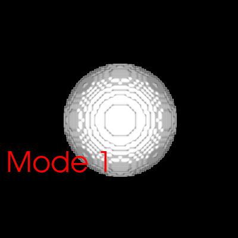

# leap-dicom-viewer

Render a CT scan as a 3D volume and turn it with your hand. The viewer reads a DICOM series with VTK and, with a Leap Motion controller, maps the tilt of your palm to the rotation of the volume, so a surgeon can inspect pre-operative images without touching a mouse.



## Controls

| With a Leap Motion controller | |
|---|---|
| Tilt your palm | Rotate the volume about all three axes |
| Raise or lower your palm | Move the camera closer or further |
| Bring a second hand into view | Freeze the volume (rotation resumes from where your hand is when you remove it) |
| Key-tap gesture | Cycle the on-screen mode label (Mode 1 → 2 → 3) |

Without a controller the mouse rotates, pans and zooms. Press **q** or **Esc** to quit.

## Build

Needs CMake 3.16+, a C++17 compiler and VTK 9.

```bash
# macOS
brew install vtk cmake
# Ubuntu 24.04
sudo apt install cmake libvtk9-dev mpi-default-dev

cmake -S . -B build
cmake --build build
ctest --test-dir build
```

To use a Leap Motion controller, install the Leap Motion SDK **v2**. The Orion SDK (v3 and later) removed the gesture API this uses.

```bash
cmake -S . -B build -DLEAP_DICOM_WITH_LEAP=ON -DLEAP_SDK_DIR=/path/to/LeapSDK
```

## Run

```bash
build/leap-dicom-viewer /path/to/dicom/series
build/leap-dicom-viewer /path/to/dicom/series --size 1280x800
build/leap-dicom-viewer /path/to/dicom/series --screenshot view.png   # render once, no window
```

The directory must hold one uncompressed DICOM series. The transfer function is set for CT: air is transparent, and voxels become opaque and white by 400 HU (bone).

No scan to hand? Generate a synthetic phantom (needs `numpy` and `pydicom`):

```bash
python tests/make_phantom.py build/phantom
build/leap-dicom-viewer build/phantom
```

## Layout

```
include/leapviewer/interaction.hpp   hand samples → rotation, camera depth, mode (no VTK, no Leap)
src/interaction.cpp
include/leapviewer/scene.hpp         DICOM reader and volume pipeline
src/scene.cpp
src/leap_input.cpp                   Leap SDK listener (built with LEAP_DICOM_WITH_LEAP=ON)
src/main.cpp                         window, timer, keys, command line
tests/                               unit tests, a stub Leap.h for compile checks, phantom generator
```

The Leap SDK calls back on its own thread. `SampleMailbox` hands the latest sample to the render thread under a mutex and counts gestures in between, so none are lost.

## Changes from the 2018 version

- Rotation about Z applied `RotateX` a second time; each axis now rotates about itself.
- The Leap thread and the render timer shared globals without synchronisation; they now go through `SampleMailbox`.
- Removing the second hand after a freeze made the volume jump by all the rotation that happened during the freeze.
- The DICOM path was hard-coded to one Windows machine; it is now a command-line argument, and a directory with no series is reported instead of rendering nothing.
- Built with CMake and VTK 9 (`vtkVolumeRayCastCompositeFunction` was removed in VTK 7). VTK objects are owned by smart pointers instead of leaked `New()` calls.
- The 2023 rename commit had deleted the listener and callback classes, so the file no longer compiled. This version restores and rewrites them.

## License

Apache-2.0
